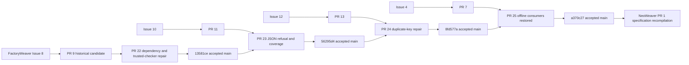

# First Inference Breakpoint 與已觀察 rework DAG

本紀錄保留原十項 NeoWeaver REQ 與原 first-breakpoint 方法。FactoryWeaver source delivery 有實際證據；NeoWeaver implementation、training、native transfer 沒有執行。PR #1 是 specification PR，不是假造的 implementation Issue。

## 先修第一個無法成立的前提

先讀原 Goal、source bytes、Consumer result 和原 Owner next。沿每個 material Producer → Consumer boundary 比較 actor、conditions、acceptance、effect authority 與 source-backed consequence。既有 unchanged legal next 為 NOOP，不新增一個模型選擇。

保存原 claim、其必要 premise、實際 counterexample、可支持的結論和原 correction Owner。定義一個正例與一個能推翻它的負例，修最早錯誤而不是後續症狀。原 oracle 不由 writer 修改。UNKNOWN／NOT_RUN 不是 FAIL，也不是 PASS；無完整 capture 不宣稱完整 decision total。

## FactoryWeaver 實際 lineage

| 原 Issue／PR | 第一個不成立前提 | 正反辨別與修正 | correcting head／accepted merge | 證據上限 |
| --- | --- | --- | --- | --- |
| [#2](https://github.com/ed3c/factoryweaver/issues/2) → [#3](https://github.com/ed3c/factoryweaver/pull/3) | 舊 bootstrap 可整份覆蓋最新 main | 原 23 controls 在 main 通過；保留 newer duplicate-key、action-target、registry 防護 | 原 source head `30eaffd359f44d00b47809b6e5491209dd1fff0f`；在新版 main 做 parity readback，沒有 merge 舊 branch | source/CLI parity，native adapter 不是該 PR receipt |
| [#8](https://github.com/ed3c/factoryweaver/issues/8) → [#9](https://github.com/ed3c/factoryweaver/pull/9) → [#22](https://github.com/ed3c/factoryweaver/pull/22) | manifest 自洽就表示 v7.2 dependencies 可讀；被驗證的 checker 可在 integrity 前執行 | foreign-root positive；缺 dependency、pycache drift、相對 root、篡改 checker 的 marker negative；trusted check 在執行前拒絕 | [head a87f08f](https://github.com/ed3c/factoryweaver/commit/a87f08f53742062aecc5cb96ee7724d3c755bee0) → [merge 13581ce](https://github.com/ed3c/factoryweaver/commit/13581ce55556e6b1ae6a491cca242d49e8fc2bd9) | 137 tests、installer copy、independent CLI；無 native Agent invocation |
| [#10](https://github.com/ed3c/factoryweaver/issues/10) → [#11](https://github.com/ed3c/factoryweaver/pull/11) → [#23](https://github.com/ed3c/factoryweaver/pull/23) | 綠 suite 表示 CLI schema 拒絕已符 Consumer contract | baseline 1/6、proposal 6/6；schema-invalid 曾 traceback/exit1，修為 JSON/exit2 並實際 feature drive | [head d6cd8cd](https://github.com/ed3c/factoryweaver/commit/d6cd8cdc504579e0ce36ca65cb90e58a1d01f692) → [merge 56295d4](https://github.com/ed3c/factoryweaver/commit/56295d49446d95e0049e248b1b87c4a892d3ef55) | 152 tests與declared trace；語義與source exhaustiveness未認證 |
| [#12](https://github.com/ed3c/factoryweaver/issues/12) → [#13](https://github.com/ed3c/factoryweaver/pull/13) → [#24](https://github.com/ed3c/factoryweaver/pull/24) | exact raw pin 可消除 duplicate-key parser ambiguity | matching synthetic positive；重複 profile/binding/catalog keys、exact-pin duplicate negative；原 verifier-route測試曾FAIL，修正後52 focused PASS | [head d6903f2](https://github.com/ed3c/factoryweaver/commit/d6903f2d3f7cc0bf263ece7450453ff2945880ac) → [merge 8fd577a](https://github.com/ed3c/factoryweaver/commit/8fd577a5c3293c61f89ff0052c8d85b0dc2aca4c) | 204 tests與linked Git fixtures；Worker/secret isolation NOT_RUN |
| [#4](https://github.com/ed3c/factoryweaver/issues/4) → [#7](https://github.com/ed3c/factoryweaver/pull/7) → [#25](https://github.com/ed3c/factoryweaver/pull/25) | card_delta 存在代表原 PR7 全功能已保留 | 恢復 source-lock/golden/blind 三 CLI＋tests；Markdown exact anchor positive，舊無 emphasis anchor negative；保留main delta原bytes | [head 2d4a39a](https://github.com/ed3c/factoryweaver/commit/2d4a39a5c663d3d70191c35eb72be56c7508c54c) → [merge a370c27](https://github.com/ed3c/factoryweaver/commit/a370c271ab6517298306e51c0f5a38c754bd71dd) | 232 tests、12 local/installed CLI；blind quality與native effects NOT_RUN |

這些箭頭記錄原功能的來源與實際 reconciliation，不宣稱 GitHub 有另建 rework Issue。所有原 Issue 的 broader semantic/native unmet gates 保留；關閉 superseded PR 不能替代 Issue Goal closure。

## 尚未觀察的 NeoWeaver 因果結果

Patch parser、Snapshot Runner、Verifier/reward join、dataset eligibility、policy update、Codex adapter 與 native scope 消費全部 NOT_RUN。候選修改 evaluator、token lineage 遺失、只觀察 joint arm、無 capability 卻宣稱 transfer 都是待測 negative cases，沒有被寫成已發生 NeoWeaver bugs。

目前規格 materialization 有真實 source/shape、clause trace、delta replay與Soodles Reader transport controls。它們不證明上述實作已存在。新的實作必須保留這條 parent Goal、這些原需求與相應缺口，從實際 source/capture 確認斷點後選 bounded atom。

## 審計限制

本次 independent reviewers 有實際 isolated CLI evidence。不同模型家族的 trail review，以及未提供完整 active-workspace transcript 的逐 turn audit 均 NOT_RUN。Source update／GitHub merge 與 native Noodle Stage 是不同 carriers，不互相代稱。計算值來自實際 Producer receipts 或編譯器；此文件沒有生成 runtime identity。
