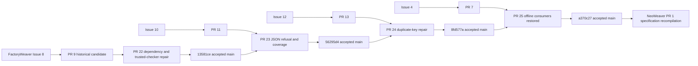

# First Inference Breakpoint 與已觀察 rework DAG

本紀錄保留原十項 NeoWeaver REQ 與原 first-breakpoint 方法。前述 specification 階段沒有 NeoWeaver implementation、training 或 native transfer；本輪純 parser 實作另記於下方。PR #1 是 specification PR，不是假造的 implementation Issue。

## 先修第一個無法成立的前提

先讀原 Goal、source bytes、Consumer result 和原 Owner next。沿每個 material Producer → Consumer boundary 比較 actor、conditions、acceptance、effect authority 與 source-backed consequence。既有 unchanged legal next 為 NOOP，不新增一個模型選擇。

保存原 claim、其必要 premise、實際 counterexample、可支持的結論和原 correction Owner。定義一個正例與一個能推翻它的負例，修最早錯誤而不是後續症狀。原 oracle 不由 writer 修改。UNKNOWN／NOT_RUN 不是 FAIL，也不是 PASS；無完整 capture 不宣稱完整 decision total。

## FactoryWeaver 實際 lineage

| 原 Issue／PR | 第一個不成立前提 | 正反辨別與修正 | correcting head／accepted merge | 證據上限 |
| --- | --- | --- | --- | --- |
| [#2](https://github.com/ed3c/factoryweaver/issues/2) → [#3](https://github.com/ed3c/factoryweaver/pull/3) | 舊 bootstrap 可整份覆蓋最新 main | 原 23 controls 在 main 通過；保留 newer duplicate-key、action-target、registry 防護 | 原 source head `30eaffd359f44d00b47809b6e5491209dd1fff0f`；在新版 main 做 parity readback，沒有 merge 舊 branch | source/CLI parity，native adapter 不是該 PR receipt |
| [#8](https://github.com/ed3c/factoryweaver/issues/8) → [#9](https://github.com/ed3c/factoryweaver/pull/9) → [#22](https://github.com/ed3c/factoryweaver/pull/22) | manifest 自洽就表示 v7.2 dependencies 可讀；被驗證的 checker 可在 integrity 前執行 | foreign-root positive；缺 dependency、pycache drift、相對 root、篡改 checker 的 marker negative；trusted check 在執行前拒絕 | [head a87f08f](https://github.com/ed3c/factoryweaver/commit/a87f08f53742062aecc5cb96ee7724d3c755bee0) → [merge 13581ce](https://github.com/ed3c/factoryweaver/commit/13581ce55556e6b1ae6a491cca242d49e8fc2bd9) | 137 tests、installer copy、independent CLI；無 native Agent invocation |
| [#10](https://github.com/ed3c/factoryweaver/issues/10) → [#11](https://github.com/ed3c/factoryweaver/pull/11) → [#23](https://github.com/ed3c/factoryweaver/pull/23) | 綠 suite 表示 CLI schema 拒絕已符 Consumer contract | baseline 1/6、proposal 6/6；schema-invalid 曾 traceback/exit1，修為 JSON/exit2 並實際 feature drive | [head d6cd8cd](https://github.com/ed3c/factoryweaver/commit/d6cd8cdc504579e0ce36ca65cb90e58a1d01f692) → [merge 56295d4](https://github.com/ed3c/factoryweaver/commit/56295d49446d95e0049e248b1b87c4a892d3ef55) | 152 tests與declared trace；語義與source exhaustiveness未認證 |
| [#12](https://github.com/ed3c/factoryweaver/issues/12) → [#13](https://github.com/ed3c/factoryweaver/pull/13) → [#24](https://github.com/ed3c/factoryweaver/pull/24) | exact raw pin 可消除 duplicate-key parser ambiguity | matching synthetic positive；重複 profile/binding/catalog keys、exact-pin duplicate negative；原 verifier-route測試曾FAIL，修正後52 focused PASS | [head d6903f2](https://github.com/ed3c/factoryweaver/commit/d6903f2d3f7cc0bf263ece7450453ff2945880ac) → [merge 8fd577a](https://github.com/ed3c/factoryweaver/commit/8fd577a5c3293c61f89ff0052c8d85b0dc2aca4c) | 204 tests與linked Git fixtures；Worker/secret isolation NOT_RUN |
| [#4](https://github.com/ed3c/factoryweaver/issues/4) → [#7](https://github.com/ed3c/factoryweaver/pull/7) → [#25](https://github.com/ed3c/factoryweaver/pull/25) | card_delta 存在代表原 PR7 全功能已保留 | 恢復 source-lock/golden/blind 三 CLI＋tests；Markdown exact anchor positive，舊無 emphasis anchor negative；保留main delta原bytes | [head 2d4a39a](https://github.com/ed3c/factoryweaver/commit/2d4a39a5c663d3d70191c35eb72be56c7508c54c) → [merge a370c27](https://github.com/ed3c/factoryweaver/commit/a370c271ab6517298306e51c0f5a38c754bd71dd) | 232 tests、12 local/installed CLI；blind quality與native effects NOT_RUN |

這些箭頭記錄原功能的來源與實際 reconciliation，不宣稱 GitHub 有另建 rework Issue。所有原 Issue 的 broader semantic/native unmet gates 保留；關閉 superseded PR 不能替代 Issue Goal closure。

## 規格階段的歷史觀察

在規格階段，Patch parser、Snapshot Runner、Verifier/reward join、dataset eligibility、policy update、Codex adapter 與 native scope 消費全部 NOT_RUN。候選修改 evaluator、token lineage 遺失、只觀察 joint arm、無 capability 卻宣稱 transfer 都是當時待測的 negative cases，沒有被寫成已發生 NeoWeaver bugs。

目前規格 materialization 有真實 source/shape、clause trace、delta replay與Soodles Reader transport controls。它們不證明上述實作已存在。新的實作必須保留這條 parent Goal、這些原需求與相應缺口，從實際 source/capture 確認斷點後選 bounded atom。

## 審計限制

本次 independent reviewers 有實際 isolated CLI evidence。不同模型家族的 trail review，以及未提供完整 active-workspace transcript 的逐 turn audit 均 NOT_RUN。Source update／GitHub merge 與 native Noodle Stage 是不同 carriers，不互相代稱。計算值來自實際 Producer receipts 或編譯器；此文件沒有生成 runtime identity。

## Parser Scope correction after ae739

The first observed specification defect was the compiler projecting one acceptance sentence into REQ measurement, SPEC then/oracle and V positive_control. SPEC08 returned data with no replay while its then asserted replay. This is an observed source/Consumer contract contradiction, not an observed Neo runtime failure.

The corrected proposal preserves all ten original statements/falsifiers and stable Card identities, bounds the local output to ParsedProposal/DiagnosticRefusal, and keeps replay/native delivery outside that exit. All ten V controls now state discriminating input/result pairs. Material typed-link explanations were updated with the same corrected I/O; K43/K44 bind only their dependent parent requirements.

Independent review first returned REVISE for T35's unconditional factorial phrase, stale link explanations, and D42's abbreviated actual enum. Corrections were read back before scoped source ACCEPT. FactoryWeaver feedback also corrected the apparent ban on proposing control inputs while leaving actual selection/execution with the original Test Manager. Review history is separate from immutable CLI results.

Actual structural controls cover the retained prior bytes, revision paging, stale cursor, forged TESTED, wrong V direction, declared dependency invalidation, Scope reuse/conflict and original Reader drift refusal. A new read-only artifact consistency helper checks proposals/record/Scope projections and refuses structural drift; it is not the PatchProposal parser or a native state machine. Previous public verification bytes remain in verification-before-parser-correction.json.

Source review ACCEPT, 8 artifact controls and local CLI maintenance do not upgrade proposed parser controls, native P-class feedback, Noodle/Managers, training or transfer. Those remain NOT_RUN. The delta's BLOCKED terminal retains source/non-card reconciliation obligations; no DONE/landing authorization was synthesized. Actual new commit/PR identities are supplied by GitHub Provider readback.

The source correction feedback is [FactoryWeaver PR #26](https://github.com/ed3c/factoryweaver/pull/26): [guidance a90f195](https://github.com/ed3c/factoryweaver/commit/a90f195e5c40030a6b90464b153e38cac7c719e2) followed by [verification 660778f](https://github.com/ed3c/factoryweaver/commit/660778f7e0602bb84e9f46f49e76a620f880ee21). These actual commits preserve the original product CLI and separate source review from native instruction compliance. At the correction stage they were proposed PR bytes; the later landing receipts are recorded below.

## 純 parser 實作與原生 Stop 的有限觀察

合併前重新讀取精確 HEAD、reviews、review threads 與 CI。兩 PR 沒有 GitHub review submission；獨立來源審查不是 GitHub Approval。FactoryWeaver #26 的 `660778f7e0602bb84e9f46f49e76a620f880ee21` 已合併為 [176d60e](https://github.com/ed3c/factoryweaver/commit/176d60ec3e2487d4a7385ee0066f20b0277a4422)，NeoWeaver #1 的 `1de71ae70baff9914f0ddd757fadb34c0ed9f733` 已合併為 [8596938](https://github.com/ed3c/NeoWeaver/commit/85969389e0be7e87708ad3419cd9ac16a4ee4515)。兩個 main push CI 均成功；來源交付不關閉父 Goal。

本輪 first unsupported premise 是「宣告的 PatchProposal schema 就能驗收 raw proposal」。Schema 看不到原 JSON 的 duplicate keys，也不能判定固定 refs、stale expected source 或 protected target。純 parser 在 raw boundary 拒絕這些輸入；合法 current single-target proposal 只回 `ParsedProposal`。正反控制直接呼叫 public API，保存原 bytes 和不可變 fixed inputs，不執行 replacement。同 target 多個完整 replacement 沒有可裁決順序，因此具名拒絕，不補造 operation 語義。十項 REQ、44 張卡和歷史 verification bytes 均保留。

本機 Codex CLI 的專用 Session 為唯讀來源審查任務透過原生 `/hooks` review/trust 暫時 Stop 定義，實際呼叫原 Soodles Hook Manager。第一次 Stop 要求原 task-review 的 `NATIVE-REVIEW` continuation；Agent 隨後讀取 parser、測試與契約。第二次 Stop 的 `stop_hook_active=true` 沒有再次續作。Supervisor 將局部讀檔觀察回填原 selection，十項父需求仍待查。這驗收的是有限事件與 consumer 接線，沒有安裝 learned patch，也不支持 REQ-plugin-transfer 或整套 P-class compliance。CLI 呼叫選擇 read-only／never，但原生 event 回報 `permission_mode=bypassPermissions`；此欄位保留原值，runtime sandbox enforcement 未驗證，不推測名稱對應。

Hook Manager 的既有 Stop adapter 沒有直接呼叫 Waza `check`，GitHub workflows 也沒有 MR → Hook Manager bridge。Remote repository webhook inventory 無可用認證，保持 UNKNOWN；不能宣稱全服務沒有 webhook。本機既有 Codex plugin 的 Stop handler 與 Soodles Hook Manager 是不同來源，也不以 Installed／Active 欄位當 check 已執行。觀察完成後撤除本次暫時 project 定義，保留私有原生 captures，不修改其他 hooks 或繞過 trust。

本輪 executable control 與 Host observation 摘要見 [parser verification](docs/parser-verification.json)。歷史編譯 helper 的 `parser_implementation=NOT_RUN` 只描述原 compiled artifact 所持證據；它不是目前程式存在性的探測器。Parser 實測、native Hook 有限觀察、MR check、replay、training、transfer 與 whole Goal 分開驗收。

## Issue #14：合法 H1 與未授權 drift 的來源邊界

[NeoWeaver #14](https://github.com/ed3c/NeoWeaver/issues/14) 的 admitted source 是
`cd52805ca37b9adcb4672b76e8ed6d668de2b259`。第一個不成立的前提是「兩個 source
copies 共用 baseline manifest，也能表達合法 H1」。本次先以真實 temporary Git
source 呼叫既有 Parser，得到 `ParsedProposal`，再寫入候選 replacement。
原 transport 回 `source_changed`，Docker invocation 為 0，capture 未建立，H0
與 Git 原檔仍為原值。這是 public API 的來源斷點，不是 Docker 或 native Replay failure。
原始診斷保存在 repository 外，沒有公開 host paths 或 transcript。

本 Issue 的實作修正 commit 是 `46457b6c16fb5da95396cf0912f988b1b2f58e91`。原 staging Producer 現在保存每 arm
manifest，並消費 caller 固定的 opaque refs、tracked path、expected bytes 與
protected paths。只替換一個 H1 target 的 hash，既有 transport 與 inspection
檢查兩 arm 的固定 bytes 和 modes。正例是合法 H1 進入 mocked Docker transport
與 inspection，H0、非 target 與 Git 原檔保持 literal expected bytes。反例是
同樣 H1 bytes 未經 bounded application，仍 `source_changed` 且 Docker 為 0。
Stale binding、protected alias、escape、symlink、後續 drift 與 capture substitution
各有拒絕控制。十項 REQ、44 Cards 與歷史 verification bytes 均未改寫。

Writer 自審與獨立 reviewer 另重現 candidate target hardlink 到 Git 原檔的問題。
原本直接寫入會把原 Git 檔改成 H1。新增 `target_hardlink` 的寫入前拒絕後，Git
與 baseline hardlink 控制都保留 H0。這修正實際觀察到的 alias write，沒有宣稱
消除 filesystem check 到 write 或 mount 之間的並行修改窗口。

本次原 Test Manager 選定的 42 個 source、transport、inspection tests 與 compiled
consistency check 已通過。獨立 writer-side review 使用此 Host 的原生 subagent；
Cursor 專用 Task、指定跨模型執行與完整 native P-class compliance 沒有被宣稱。
Docker daemon 的唯讀探測有回應，但本 admission 沒有提供原 Owner 固定的 image
與 task，故沒有 live Docker task、isolation、oracle 或 `RunReadback` PASS。

這條 rework edge 是原 source commit → Issue #14 → 上述實作 commit。
目前沒有本次 PR、merge 或 closure 的 Provider receipt。原 Issue-atom、Test、Schema
與 landing Owners 繼續各自交付與驗收；Writer outcome 不等於這些 receipts。
Native Replay、RL training、frozen Codex transfer 與 whole Goal 繼續 OPEN。

## Issue #16：完成事件與獨立 Oracle 接到原 pair API

[NeoWeaver #16](https://github.com/ed3c/NeoWeaver/issues/16) 的原 source 是
`c071f590905a4cd1d43ce983e2be33445fe22c63`。第一個不成立的前提是
「exit 0、第一則 agent_message 或一個輸出檔足以證明任務完成」。歷史 raw
只含 commentary 與未完成 turn；歷史 resumed trace 另有完整 turn。兩份來源
分別讀取，沒有拼接或當成這次 live proof。

本次 `run_native_arm` 保存真正的 launch、process 與 raw bytes，
`inspect_native_pair` 以原先固定的 parser-response Oracle 判斷後，呼叫原
`inspect_pair` 一次。正例需要 completed turn、最後 agent message 和輸出檔
一致；反例包括 commentary、file-only、turn.failed、malformed events 及
有效但錯誤的 literal condition。每臂保留自己的 task/model/schema/budget/source，
不同 launch 不會被 inspection 時的共用 references 蓋掉。

實作 edge 是原 source → Issue #16 → `4d74764` native boundary →
`4ddf98e` 原 pair 接線 → `1910383` live driver。獨立 integration/security
review 在初始 committed diff 重現三項缺陷。`item.started` 尚未完成卻有
`turn.completed` 時被接受；含 `..` 的 capture path 繞過 source overlap；
escaped lone surrogate 使 decoder 拋例外。`55c3bd3` 追蹤 item lifecycle，
`e8d35ee` 在 launch 前 canonicalize path 並拒絕 malformed message encoding。
對應正反 fixtures 均在修正後通過。終審另在 temporary repository 重現
live driver 的 relative／`..` evidence root 也能繞過 repository overlap。
`07bdda3` 將 driver root 同樣 canonicalize；新控制確認拒絕時沒有讀取
pinned task、寫入 Oracle 或啟動 native。這不影響已觀察的絕對私有 live root，
沒有因此替換或重跑兩個原 capture。這些是實際 review/correction edges，
沒有另造 rework Issue 或 Provider receipt。

實際 validation-only H0/H0 使用 clean source commit
`e8d35ee5a3d3744c9e7b795f4ae7b9d589ee23fd`。兩個 unchanged source arms
各經新 product API 啟動 installed Codex 一次，使用相同 `gpt-6-astra`、
`high` effort、240 秒 deadline、task/schema/population 和 Provider-default
seed policy。相同政策不證明 realized seed 相同。兩個實際 thread 不同，
process exit 均為 0，source 前後未 drift，最後訊息與輸出檔一致，
獨立三例 Oracle 結果均為 `MATCH_SCOPED`。真實 raw NDJSON、stderr、
launch/process/source records 與固定 Oracle 保存在 repository 外的私有 root。

原 pair 結果是 `INCONCLUSIVE`。本次沒有原 opaque snapshot/task/environment/
solver/seed-policy/budget/oracle/harness refs，API 保留逐臂具名缺口，沒有從
路徑或字串補造原 Owner references。真實選擇與來源仍保存在各 capture；
`launch_mismatches` 為空。`sandbox_ref=None`、`effect_status=unknown` 和
`isolation_verified=false` 保持不變。沒有把 CLI read-only request 當成
Host isolation，也沒有把兩個 scoped matches 當成 paired gain。

這是 source-assisted validation，public parser source/tests 可讀；沒有
held-out、H1、learning update 或 learned artifact transfer。Native source
commit 與其後的文件／manifest commits 分開記錄，不能把後來 HEAD 冒稱為
先前 launch source。完整十項 REQ、44 Cards 與歷史 NOT_RUN bytes 未改寫。
逐 REQ 未完成證據見 [native contract](docs/native-replay-contract.md)。

Writer-side native subagents 使用 Waza check 與原 Soodles review-writing 作
唯讀 integration/security 審查；不同模型家族執行為 NOT_RUN。最終 exact-head
review、原 Test/Schema、matching-head CI、publication/landing 各有自己的
readback，不能由這段 source 紀錄代替。當前沒有本 Issue 的 PR/merge/closure
receipt，原 Provider 接續交付。Parent Goal 仍 OPEN。
